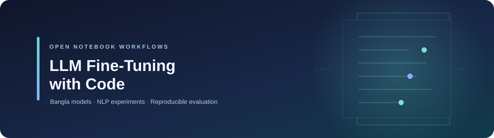

# LLM Fine-Tuning Notebooks


<p align="center">
  
</p>

Practical, end-to-end notebook workflows for adapting open models to Bangla and other NLP tasks. The repository includes Gemma 3 fine-tuning projects, a RoBERTa fake-news classifier, evaluation and baseline comparisons, model-card generation, and Hugging Face Hub publishing.

> These are hosted notebook workflows for Google Colab and Kaggle. Training requires a compatible GPU runtime; the notebooks install their own dependencies.

## Contents

- [Projects](#projects)
- [Repository layout](#repository-layout)
- [Getting started](#getting-started)
- [Datasets and model outputs](#datasets-and-model-outputs)
- [License](#license)
- [Connect](#connect)

## Projects

| Notebook | Task | Base model | Platform | What it does |
| --- | --- | --- | --- | --- |
| [`bangla-gpt-pro.ipynb`](notebooks/bangla/bangla-gpt-pro.ipynb) | Bangla instruction tuning | Gemma 3 1B Instruct | Kaggle, T4 | Resumable full fine-tuning, held-out perplexity and benchmark evaluation, charts, model card, and GGUF export. The notebook targets 80,000 training examples and can resume across Kaggle sessions using a private Hub checkpoint repository. |
| [`bangla-summarizer-pro.ipynb`](notebooks/bangla/bangla-summarizer-pro.ipynb) | Bangla news summarization | Gemma 3 1B Instruct | Kaggle, T4 | Fine-tunes on Bengali XL-Sum, compares generation against the base model and a Lead-3 baseline, and reports chrF++ and ROUGE-L. It also creates charts, a model card, and GGUF files. |
| [`liar-roberta-colab.ipynb`](notebooks/supervised/liar-roberta-colab.ipynb) | Fake-news classification | RoBERTa base | Google Colab, T4 recommended | Converts LIAR's six labels into a binary real/fake task, compares TF-IDF and majority baselines, evaluates calibration and errors, publishes a model card, and includes an optional ONNX export and quantization workflow. |
| [`gemma-3-1b-paraphrase-full-finetune-t4.ipynb`](notebooks/unsloth/gemma-3-1b-paraphrase-full-finetune-t4.ipynb) | Paraphrase generation | Gemma 3 1B Instruct | Google Colab, T4 | Fine-tunes Gemma 3 for sentence paraphrasing, compares semantic similarity and wording diversity against baselines, and publishes evaluation charts and a model card. The embedding and tied output-head parameters can be frozen to fit the T4 memory budget. |

Each notebook contains its own setup, training, evaluation, and publishing instructions. Read its opening cells before running it; settings, runtimes, and expected artifacts vary by project.

## Repository layout

```text
.
├── assets/
│   └── banner.svg
├── notebooks/
│   ├── bangla/
│   │   ├── bangla-gpt-pro.ipynb
│   │   └── bangla-summarizer-pro.ipynb
│   ├── supervised/
│   │   └── liar-roberta-colab.ipynb
│   └── unsloth/
│       └── gemma-3-1b-paraphrase-full-finetune-t4.ipynb
├── LICENSE
└── README.md
```

## Getting started

1. Clone or download this repository, then open the notebook for the project you want to run.

   ```bash
   git clone https://github.com/Md-Emon-Hasan/LLM-Full-Finetuning-with-Code.git
   cd LLM-Full-Finetuning-with-Code
   ```

2. Open the notebook in its intended hosted environment. Use Google Colab for the RoBERTa and paraphrase notebooks; use Kaggle for the two Bangla notebooks. You can upload the `.ipynb` file or open it from the repository in the platform's notebook interface.

3. Select the GPU runtime specified at the top of the notebook. The Gemma workflows are configured around a 16 GB NVIDIA T4. The RoBERTa classifier is lighter, but a T4 is recommended for the documented run.

4. Check the notebook's account and token instructions. The publishing workflows need a Hugging Face account with a **write** access token. Store it in the platform's secret manager when supported (`HF_TOKEN` on Kaggle) or use the notebook's interactive login cell on Colab. Set the Hugging Face username or repository name if the notebook asks you to.

5. Run the notebook from the first cell and review the printed dataset sizes, GPU details, evaluation outputs, and Hub destinations. Some training sessions take hours. For the resumable Bangla instruction run, follow its `Save Version → Save & Run All (Commit)` instructions and do not change its training target between sessions.

The notebooks publish model weights and, where applicable, GGUF or ONNX artifacts to Hugging Face. This repository itself contains the notebook source, not those generated model files or training datasets.

## Datasets and model outputs

The notebooks load data from external sources at run time; datasets are not bundled here.

| Workflow | Dataset source(s) | Main outputs |
| --- | --- | --- |
| Bangla instruction tuning | [`md-nishat-008/Bangla-Instruct`](https://huggingface.co/datasets/md-nishat-008/Bangla-Instruct) | Fine-tuned Gemma model, benchmark/evaluation results, charts, generated model card, and a separate GGUF repository. A private Hub repo stores resumable checkpoints. |
| Bangla summarization | [XL-Sum Bengali](https://huggingface.co/datasets/csebuetnlp/xlsum) (with loader fallbacks in the notebook) | Fine-tuned model, generation metrics and charts, generated model card, and GGUF files. |
| LIAR classification | LIAR, loaded using Hub or raw-file fallbacks in the notebook | Binary RoBERTa classifier, baseline and error-analysis results, charts, model card, and optional fp32/int8 ONNX exports. |
| Paraphrase generation | [`humarin/chatgpt-paraphrases`](https://huggingface.co/datasets/humarin/chatgpt-paraphrases), with a positive-pair fallback to [PAWS](https://huggingface.co/datasets/google-research-datasets/paws) | Fine-tuned Gemma model, paraphrase metrics and charts, and generated model card. |

Model repositories are created or selected by each notebook at run time. For example, the notebooks currently configure the Hub account `emonHasan01`; confirm the target repository in the notebook before publishing. Evaluation scores are computed during a run and are intentionally not stated here as fixed results.


## License

This repository is licensed under the [Apache License 2.0](LICENSE). The license for each upstream model, dataset, or generated artifact may differ.

## Connect

- **Portfolio:** [emonlabs-ai.hitechparks.com](https://emonlabs-ai.hitechparks.com)
- **GitHub:** [Md-Emon-Hasan](https://github.com/Md-Emon-Hasan)
- **LinkedIn:** [Md Emon Hasan](https://www.linkedin.com/in/md-emon-hasan-695483237/)
- **Hugging Face:** [emonHasan01](https://huggingface.co/emonHasan01)
- **Email:** [emon.mlengineer@gmail.com](mailto:emon.mlengineer@gmail.com)
- **WhatsApp:** [+880 1834-363533](https://wa.me/8801834363533)
